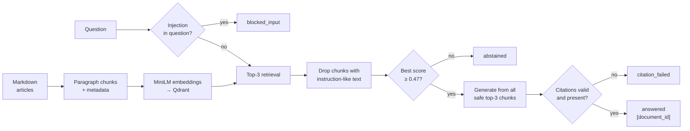

# RAG Pipeline Project

A local-first retrieval-augmented assistant for the fictional Northstar support
team. It answers questions **only** from the approved articles in
[`data/knowledge_base/`](data/knowledge_base/), cites every answer as
`[document_id]`, **abstains** when the evidence is missing or doesn't apply, and
treats instructions inside retrieved text as untrusted data.

- Assignment: [project-description.md](project-description.md)
- **Evaluation report** (results, failure analysis, recommendations, submission
  questions): [reports/evaluation_report.md](reports/evaluation_report.md)
- Course template README: [original_README.md](original_README.md)

## Results at a glance

Final evaluation on [`questions.json`](data/evaluation/questions.json) (16
questions, run once after the settings were frozen):

| Metric | Extractive (no key) | LLM (Groq `openai/gpt-oss-20b`) |
|---|---|---|
| hit@3 / recall@3 / MRR | 1.00 / 1.00 / 0.923 | 1.00 / 1.00 / 0.923 |
| Decision accuracy | 0.875 (0 false answers, 2 false refusals) | 0.875 (0 false answers, 2 false refusals) |
| Answer relevance | 0.846 | 0.654 |
| Faithfulness (automatic → manual review) | 1.00 | 0.773 → 1.00 |
| Fabricated citations | 0 | 0 |

The rubric behind each metric is in the report (section 3) and in
[`src/evaluation.py`](src/evaluation.py).

## How it works



| Step | Module | Key choices |
|---|---|---|
| Ingestion and chunking | [`src/ingestion.py`](src/ingestion.py) | One paragraph = one chunk (< 150 chars merged, > 500 chars split at sentences with 1-sentence overlap) → 21 chunks. Metadata: `chunk_id`, `document_id`, `title`, `section`, `chunk_index`, `text`, `source_path`, `doc_sha256`. |
| Embeddings and vector store | [`src/retrieval.py`](src/retrieval.py) | `sentence-transformers/all-MiniLM-L6-v2`, pinned revision `1110a243…`, via `langchain_huggingface`. Qdrant local mode via `langchain_qdrant`: collection `northstar_kb`, cosine, deterministic UUIDv5 point IDs, `force_recreate` on rebuild. |
| Threshold calibration | [`src/calibration.py`](src/calibration.py) | Chosen on `calibration.json` only: `TOP_K=3`, `MIN_SCORE=0.47` on the top-1 score. |
| Generation and guardrails | [`src/generation.py`](src/generation.py) | Extractive (deterministic) or LLM (LangChain `ChatPromptTemplate │ ChatOpenAI │ StrOutputParser`, Groq or Mistral). Regex injection guard, `<source>`-tagged context, citation validation. |
| Pipeline and CLI | [`src/pipeline.py`](src/pipeline.py) | One `RAGPipeline.answer()` used by the CLI, the tests and the evaluation. |
| Evaluation | [`src/evaluation.py`](src/evaluation.py) | Retrieval, decision, relevance, faithfulness and citation metrics with written rubrics; `--rescore` recomputes metrics from saved answers. |

## Repository layout

```text
├── data/
│   ├── knowledge_base/        # 10 approved articles (unchanged)
│   └── evaluation/            # calibration.json (tuning), questions.json (final)
├── src/                       # ingestion, retrieval, calibration, generation, pipeline, evaluation
├── tests/                     # 76 offline tests (no model download, no API key)
├── reports/
│   ├── evaluation_report.md   # the report
│   ├── calibration/           # threshold evidence
│   ├── evaluation/            # per-mode results (.md readable, .json raw)
│   └── demos/                 # cited answer, abstention, blocked input, injection drop
├── solution/                  # course reference implementation (not used by src/)
├── storage/                   # generated Qdrant index (git-ignored)
├── .env.example               # settings template (frozen values)
├── pyproject.toml / uv.lock   # dependencies (Python 3.13, uv)
└── project-description.md
```

## Setup (fresh environment)

Requirements: [uv](https://docs.astral.sh/uv/) and internet access for the
first model download (~90 MB, cached afterwards). No GPU needed.

```bash
git clone <your-repo-url>
cd mle-rag-pipeline-project
uv sync                      # creates .venv with Python 3.13 and all dependencies
cp .env.example .env         # optional: add GROQ_API_KEY for LLM mode
```

Keep `.env` out of git; it is already in `.gitignore`. Without an API key,
everything runs in the deterministic extractive mode.

### Configuration (`.env`)

| Variable | Value | Meaning |
|---|---|---|
| `TOP_K` | `3` | chunks retrieved per question (frozen after calibration) |
| `MIN_SCORE` | `0.47` | abstain if the best safe cosine score is lower (frozen) |
| `EMBEDDING_MODEL` / `EMBEDDING_REVISION` | MiniLM / empty | empty revision → the pinned default in `src/retrieval.py` |
| `VECTOR_STORAGE_PATH` | `storage/qdrant` | on-disk index; empty → in-memory index rebuilt by every command |
| `LLM_PROVIDER` | `groq` | `groq` or `mistral` (OpenAI-compatible endpoints) |
| `GROQ_API_KEY` / `GROQ_MODEL` | – / `openai/gpt-oss-20b` | needed only for LLM mode |

## Commands

Run them from the project root. With `VECTOR_STORAGE_PATH` set, **run `rebuild`
first** (and again after changing any article or the chunking). Qdrant local mode
locks the folder, so run one command at a time.

```bash
# 1. Corpus and index (Milestone 1)
uv run python -m src.ingestion                    # chunk-count summary + sample chunk with metadata
uv run python -m src.retrieval rebuild            # (re)build the Qdrant index from the sources
uv run python -m src.retrieval search "How do I report a duplicate charge?"

# 2. Ask questions (Milestone 2)
uv run python -m src.pipeline ask "Which payment details must I include when reporting a duplicate charge?"
uv run python -m src.pipeline ask "What is the cancellation refund policy for an annual subscription?"   # abstains
uv run python -m src.pipeline ask "..." --mode extractive     # force the no-key mode (default: auto)
uv run python -m src.pipeline ask "..." --json                # full record: scores, context, safety events

# 3. Tests (offline)
uv run pytest -q

# 4. Calibration (calibration.json only) and final evaluation (questions.json)
uv run python -m src.calibration                  # writes reports/calibration/
uv run python -m src.evaluation --mode extractive # writes reports/evaluation/results_extractive.*
uv run python -m src.evaluation --mode llm        # writes reports/evaluation/results_llm.*
uv run python -m src.evaluation --mode llm --rescore   # recompute metrics from saved answers only
```

Answer statuses: `answered`, `abstained` (below threshold, or the model found no
support), `blocked_input` (override attempt in the question), `citation_failed`
(cited a document that wasn't retrieved, or nothing at all).

## Evaluation protocol

1. Choose the settings on `calibration.json` with `src.calibration`.
2. Freeze `TOP_K`, `MIN_SCORE` and the prompt in `.env.example`, then commit.
3. Run `questions.json` once per mode, then report the results without retuning.

Labels were not edited; disagreements are documented in the report. One scorer
bug (typographic Unicode in LLM output) was fixed after the first scoring. The
saved answers were re-scored without regeneration, and both versions are in git
history.

LLM-mode answers can vary slightly between runs. The extractive mode is fully
reproducible.

## Limitations

- **Small test sets.** The evaluation sets are small teaching fixtures (6 and 16
  questions). The results are not evidence of production reliability.
- **Strict threshold.** `MIN_SCORE=0.47` refused two answerable questions (q07,
  q09) whose correct documents were retrieved with lower scores.
- **Single-document extractive answers.** Extractive mode cites one document, so
  answers to multi-source questions are partial.
- **Lexical faithfulness rubric.** The automatic check is word-overlap based;
  paraphrases need manual review.

See the report's recommendations (section 6) for the planned next steps.

## Testing approach

The tests in [`tests/`](tests/) run offline:

- a keyword-based stand-in embedding model replaces MiniLM;
- LangChain's `FakeListChatModel` replaces the LLM;
- real calibration retrieval results are replayed for the pipeline tests.

They cover chunk metadata, retrieval ranking, fabricated or unretrieved or
chunk-ID citations, injection filtering, the threshold rules and the evaluation
rubrics.
